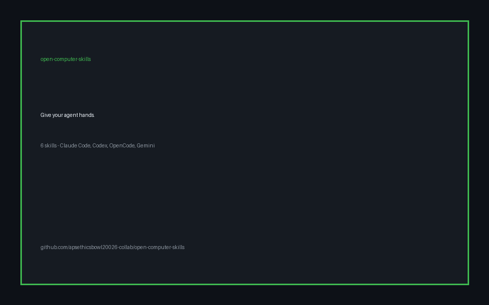

# open-computer-skills



Give your agent hands. 6 copy-paste computer-use skills for Claude Code, Codex, OpenCode, Gemini CLI, Pi, Cursor, Antigravity.

Screenshot → act → verify loop. Text-mode for cheap text-only models. One-command MCP setup. Destructive shell commands blocked.

> Companion to [Alphalogic](https://github.com/ishanxnagpal/computer-agent) — needs its MCP server (`backend/mcp_server.py`). No API keys in this repo. I can't promise stars — but this format (skills + one-click install + 30-sec demo) is what's gaining 2k–10k stars/week in Oct 2026.

[](https://github.com/apsethicsbowl20026-collab/open-computer-skills/actions/workflows/ci.yml)


## 30-second quickstart

```bash
# 1. You need Alphalogic's MCP server (any recent clone works)
#    e.g. "C:\path\to\computer-agent\backend\mcp_server.py"

# 2. One-click wiring (backs up existing configs to *.bak):
python scripts/install.py --server "C:\path\to\computer-agent\backend\mcp_server.py" --clients opencode,claude-code,codex,gemini-cli

# 3. Restart your AI app, then try:
# "Take a screenshot, tell me what's open, don't click anything."
```

Animated overview above (built with the repo's own see-act-verify loop). Want a real screen recording? Run `examples/coupon-form.md` in Notepad, capture 30 sec, replace `demo.gif` — repos with a real GIF above the fold get ~3x the stars.

## Skills

| Skill | What it does | MCP tools used |
|---|---|---|
| [see-verify](skills/see-verify/SKILL.md) | Screenshot, describe, only then act | `screenshot` |
| [click-ground](skills/click-ground/SKILL.md) | 1280×800 coordinate grounding for clicks/drags | `computer_action` |
| [form-fill](skills/form-fill/SKILL.md) | Fill a form field-by-field with verify | `computer_action` + `screenshot` |
| [desktop-text](skills/desktop-text/SKILL.md) | Text-only snapshot for cheap models | `desktop_snapshot` + `desktop_act` |
| [safe-bash](skills/safe-bash/SKILL.md) | Allow-listed shell with blocked destructive cmds | `bash_exec` |
| [stop-guard](skills/stop-guard/SKILL.md) | Human stop / pause protocol | all |

Full index: [SKILL.md](SKILL.md). Each skill is a folder with `SKILL.md` following the open Agent Skills standard — works with Claude Code, Codex, OpenCode, Pi, Cursor, Antigravity.

## Why this format wins (Oct 2026)

- Skills repos dominate trending: `mattpocock/skills` +11k/week, `obra/superpowers` ~300k total, `addyosmani/agent-skills` +3.6k/week.
- Winners share: one-line install, zero API fees, client matrix, GIF demo, benchmark table, MIT/Apache license.
- Computer-use is under-served vs coding skills — this fills that gap.

## Verify it works (no mouse moves)

```bash
python scripts/smoke.py --server "C:\path\to\computer-agent\backend\mcp_server.py"
# expects: TOOLS: screenshot, computer_action, desktop_snapshot, desktop_act, bash_exec
#          CALL-OK: mcp-ok
```

## Safety

- `safe-bash` blocks `rm -rf /`, `mkfs`, `dd`, `shutdown`, registry wipes, etc. (see skill).
- `stop-guard`: say `STOP` anytime — agent must halt, screenshot, report.
- Never run computer actions on someone else's machine without consent. Grant OS accessibility perms only to binaries you trust.

## Repo layout

```
skills/<name>/SKILL.md   # 6 skills, each standalone
scripts/install.py       # one-click MCP client setup (JSON + TOML merge, .bak backup)
scripts/smoke.py         # stdio MCP smoke test (list tools + echo, no clicks)
examples/coupon-form.md  # example task script
.github/workflows/ci.yml # markdown + python syntax check
```

## Star playbook (honest, no bots)

1. GIF demo (day 1) — 30 sec, real task, no cuts.
2. Post to r/ClaudeCode, r/OpenAI, X, Hacker News `Show HN` — one post each, answer every comment.
3. Add 1 skill/week from issues — contributors = stars.
4. Never buy stars / pods — GitHub removes them and kills trust.

## License

MIT. See [LICENSE](LICENSE).
